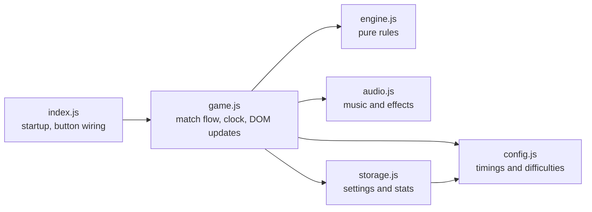
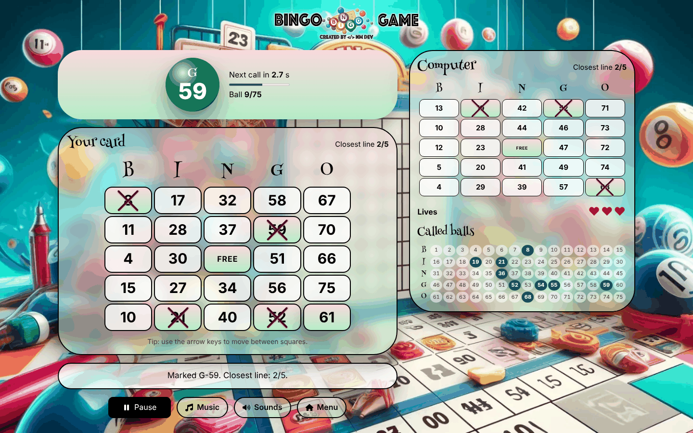
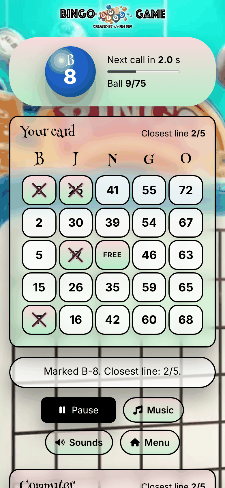
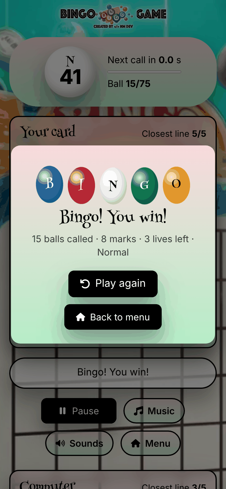
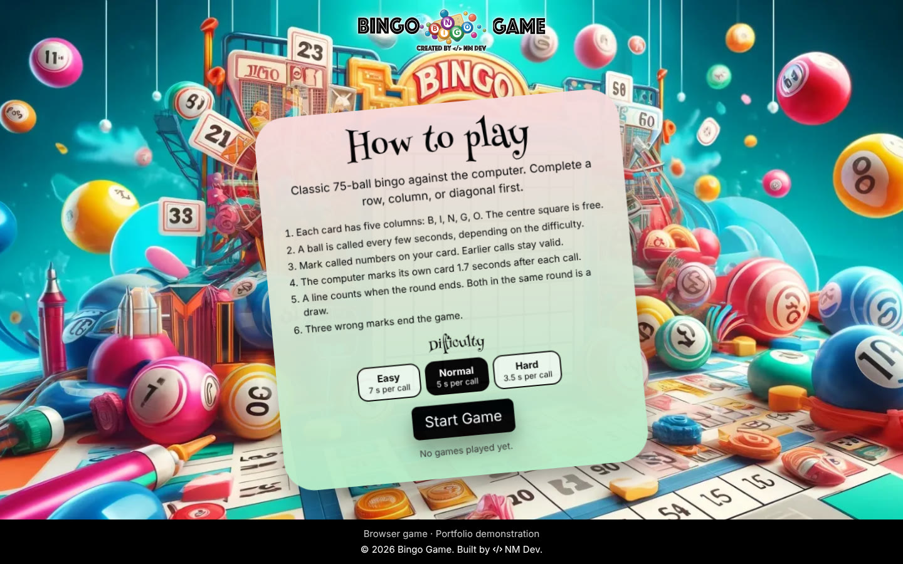
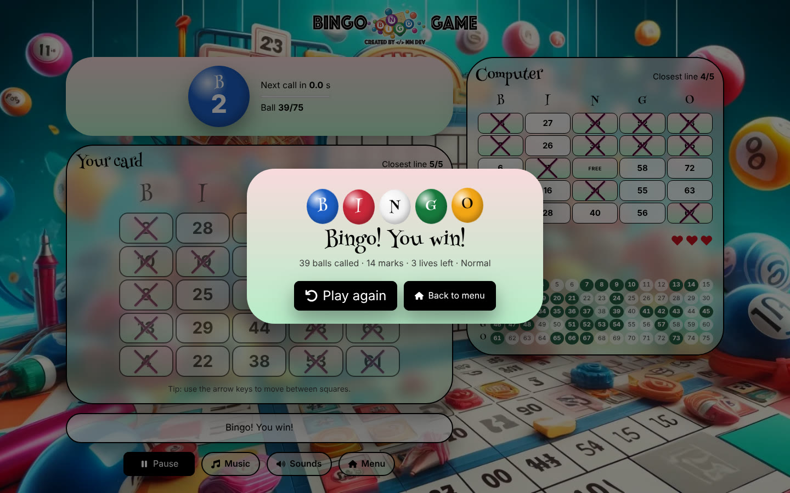
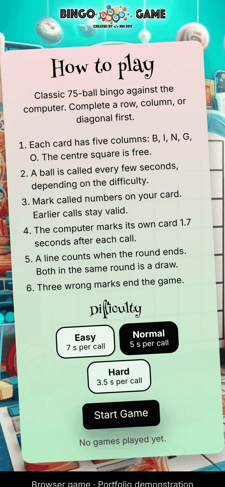

<a id="top"></a>

<div align="center">

  

  <h1>🎱 Bingo Game</h1>

  <h3>Classic 75-ball bingo against a computer opponent, built with vanilla JavaScript.</h3>

  <p>
    <a href="https://nitzanm23.github.io/bingo-game/">
      
    </a>
  </p>

  <p>
    
    
    
    
    <a href="https://github.com/nitzanm23/bingo-game/actions/workflows/ci.yml">
      
    </a>
  </p>

</div>

<p align="center">
  
</p>

---

## 🎯 Overview

**Bingo Game** is a browser game of classic 75-ball bingo against the computer. Every call runs on a timer, so the challenge is to spot and mark each number on your card before the round ends, without marking a number that has not been called.

It has no framework and no build step. The rules live in a pure JavaScript module with no DOM, which lets a suite of 45 automated tests run the real game logic in Node, from card generation to complete scripted matches.

> **Scope:** A single-player game that runs entirely in the browser. There are no accounts or online play; settings and your win/loss record are saved on your own device.

---

## 🎲 How to Play

1. Pick a difficulty: **Easy** (7 s per call), **Normal** (5 s), or **Hard** (3.5 s).
2. Each card has five columns, B, I, N, G, and O, each with its own range of numbers (B 1–15 … O 61–75). The centre square is free.
3. A ball is called every round, for example **G-52**. If it is on your card, tap or click it. Earlier calls stay valid, so a missed number can still be marked later.
4. The computer marks its own card 1.7 seconds after each call.
5. A full row, column, or diagonal counts when the round ends. If you both complete a line in the same round, it is a draw.
6. Marking a number that has not been called costs a life. Three wrong marks end the game.

---

## ✨ Features

- **Real bingo cards:** Column ranges, a free centre square, and calls announced with their letter, shown on a colored ball like a real caller's.
- **Caller's board:** All 75 balls in B-I-N-G-O rows, lighting up as they are called.
- **Three difficulty levels:** The round length changes, so you control how much time you get to find each number.
- **Saved progress:** Your difficulty, music and sound choices, and win/loss/draw record are kept between visits.
- **Keyboard play:** Arrow keys move around the card (skipping the free square), and Enter or Space marks a number.
- **Pause and fair play:** Pause freezes the clock and both cards. Switching tabs pauses the match automatically.
- **Animated results:** Five B-I-N-G-O balls bounce for a win, fall for a loss, and sway for a draw, drawn in CSS instead of GIFs.

---

## 🧠 Technical Highlights

- **Rules separated from the screen:** `engine.js` holds the game rules as pure functions (card generation, winning lines, round results) with an injectable random source, so they are easy to test and reuse.
- **A fair clock:** Rounds measure real elapsed time with `performance.now()` instead of counting timer ticks, so a slow or throttled timer never changes a round's length. A click that lands after the deadline first settles the round it missed, so it cannot overturn a result.
- **Results decided per round, not per click:** Both players get the whole round, then the result is checked once, so the order of events can never award a win.
- **Accessible game board:** The card is a real table with column headers. Squares are buttons with labels like "G-52, marked", only one square is in the tab order (roving `tabindex`), and the result is a native `<dialog>` with built-in focus handling.
- **Defensive storage:** Saved data is validated on load. Corrupted JSON, tampered values, or blocked storage fall back to safe defaults instead of breaking the game.
- **Original, balanced sound effects:** Every effect is synthesized from plain waveforms by a small Python script in `tools/`, so the game ships no third-party samples. Each effect is scaled to the same loudness, and the music plays a few steps quieter, so every call and mark is heard over it.

---

## 🏗️ Architecture



| Module       | Responsibility                                                        | Touches the DOM |
| ------------ | --------------------------------------------------------------------- | :-------------: |
| `engine.js`  | Cards, deck, call names, winning lines, round results                 |       No        |
| `config.js`  | Every timing and limit, plus the difficulty levels                    |       No        |
| `storage.js` | Loading, validating, and saving settings and statistics               |       No        |
| `audio.js`   | Background music and sound effects, created only when first needed    |       No        |
| `game.js`    | One match at a time: state, round clock, computer turn, screen output |       Yes       |
| `index.js`   | Connects buttons and settings to `game.js` at startup                 |       Yes       |

---

## 🧪 Testing

The project has **45 tests** written with Node's built-in test runner, so there is nothing to install:

```bash
npm test
```

| File                    | What it checks                                                                                                                    |
| ----------------------- | --------------------------------------------------------------------------------------------------------------------------------- |
| `tests/engine.test.js`  | Deck and card generation over many seeds, column ranges, the free square, all 12 winning lines, round results                     |
| `tests/flow.test.js`    | Scripted matches in a simulated browser: wins, losses, draws, lives, pause, tab switching, difficulty, keyboard navigation, audio |
| `tests/storage.test.js` | Defaults, saving and reloading, corrupted and tampered data, storage that throws                                                  |
| `tests/audio.test.js`   | Lazy loading, music rules, effect replay, blocked playback                                                                        |
| `tests/startup.test.js` | Button wiring, restoring the saved difficulty, Escape on the result dialog                                                        |
| `tests/assets.test.js`  | Unique ids, ARIA references, every file, sound, and icon the code uses, README links                                              |

The flow tests run the real `game.js` against a small fake DOM, a controllable clock, and a fake `Audio` (`tests/helpers/fake-dom.js`), so a full match plays out in milliseconds. They check behavior, not layout; the layout was checked in Chrome at 390px and 1440px, with axe-core and Lighthouse.

---

## 🧰 Tech Stack

- **HTML5 & CSS3:** custom properties, BEM, Grid, Flexbox, native `<dialog>`, `inert`
- **Vanilla JavaScript (ES modules):** no framework, no bundler
- **Node.js 22 `node:test`:** unit and behavior tests, no dependencies
- **Python + NumPy + ffmpeg:** sound effect generator (`tools/make-sfx.py`, not needed to play)
- **Henny Penny:** self-hosted display font in `vendor/fonts/`
- **Font Awesome Free 6.7.2:** 8 icons in one SVG sprite (`assets/icons/icons.svg`)
- **GitHub Actions:** tests, HTML validation, Lighthouse CI, and GitHub Pages deployment

---

## 📁 Project Structure

```text
bingo-game/
├── index.html
├── manifest.webmanifest  # home screen name, colors, and icons (install as an app)
├── package.json          # "npm test" script and Node version; no dependencies
├── assets/
│   ├── audio/            # background music and six original sound effects
│   ├── icons/            # favicon, home screen icons, icon sprite
│   ├── images/           # opening and game backgrounds, social preview image
│   └── logos/
├── styles/
│   ├── tokens.css        # design tokens (colors, ball colors, spacing, motion)
│   ├── reset.css         # browser defaults, focus ring, reduced motion
│   ├── page-loader.css   # opening screen and backgrounds
│   └── index.css         # layout and components
├── scripts/
│   ├── engine.js         # game rules (pure functions)
│   ├── config.js         # timings and difficulty levels
│   ├── storage.js        # saved settings and statistics
│   ├── audio.js          # music and sound effects
│   ├── game.js           # match flow, round clock, screen updates
│   ├── index.js          # startup and button wiring
│   └── page-loader.js    # opening screen (runs before first paint)
├── tests/                # node:test suites and the fake browser helper
├── tools/
│   └── make-sfx.py       # generates the sound effects
├── vendor/               # self-hosted font and license files
├── docs/                 # README screenshots, demo GIF, signatures
└── .github/              # CI workflow, html-validate and Lighthouse settings
```

---

## 🚀 Getting Started

### Play locally

The game uses ES modules, which browsers do not load from `file://`. Start any static server in the project folder:

```bash
npx http-server -c-1
```

Then open the address it prints (usually `http://localhost:8080`).

### Run the tests

Requires Node.js 22 or newer:

```bash
npm test
```

### CI & deployment

Every push and pull request runs [`ci.yml`](.github/workflows/ci.yml): the test suite, `html-validate`, and Lighthouse CI, which fails the run if Accessibility, Best Practices, or SEO drop below 95. Pushes to `main` that pass are deployed to GitHub Pages, publishing only the files the browser needs (no tests, tools, or docs).

---

## 📸 Screenshots

<table>
  <tr>
    <td width="64%" valign="top"></td>
    <td width="18%" valign="top"></td>
    <td width="18%" valign="top"></td>
  </tr>
</table>

<details>
  <summary>Start screen and result (desktop, mobile)</summary>
  <br />
  
  
  
</details>

---

## 🔭 Possible Improvements

- Add other winning patterns (four corners, blackout) as game modes.
- Let the computer make occasional mistakes on easier levels, so it feels less mechanical.
- Add a service worker so the installed app also works offline.

---

## 🙏 Credits & License

- **Music:** "Clowns" by [Tanner Helland](https://github.com/tannerhelland/free-music), licensed under [CC BY 4.0](https://creativecommons.org/licenses/by/4.0/). Re-encoded to 128 kbps to reduce its size.
- **Sound effects:** Original, generated by [`tools/make-sfx.py`](tools/make-sfx.py).
- **Artwork:** The logo is my own design. The two background illustrations were generated with AI for this project.
- **Libraries & fonts:** Henny Penny (OFL 1.1) and Font Awesome Free icons (CC BY 4.0). License files are in `vendor/`.
- **License:** My own code is released under the [MIT License](LICENSE). Third-party assets above keep their own terms.

---

## 👤 About Me

<div align="center">

  <h3>NM Dev · Nitzan Mizrachi</h3>

  <p>
    <a href="https://nm-dev.com">
      
    </a>
    <a href="https://www.linkedin.com/in/nitzan-mizrachi/">
      
    </a>
    <a href="mailto:nitzanm23@gmail.com">
      
    </a>
    <a href="https://github.com/nitzanm23">
      
    </a>
  </p>

  <table align="center">
    <tr>
      <td align="center">
        
      </td>
      <td align="center">
        
      </td>
    </tr>
  </table>

  <p><a href="#top">⬆ Back to top</a></p>

</div>
